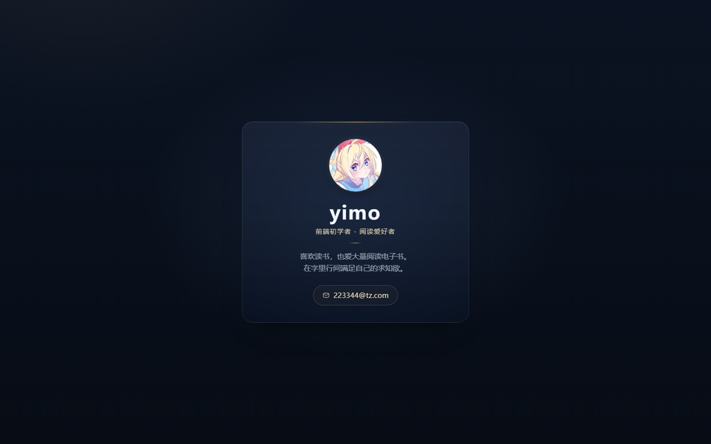
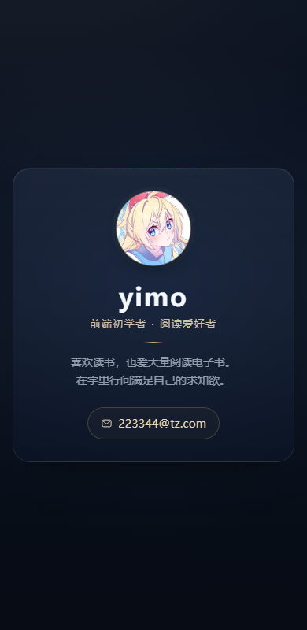

# yimo · 个人名片

一张深夜蓝配暖金的极简个人名片，纯 HTML + CSS，无任何依赖。

## 预览

| 桌面端 | 手机端 |
| --- | --- |
|  |  |

## 本地查看

双击 `index.html`，或用任意静态服务器打开：

```bash
python -m http.server 8000
# 浏览器访问 http://localhost:8000
```

## 结构

```
index.html      页面结构与样式（单文件，内联 CSS）
avatar.jpg      头像（512×512，圆形裁切由 CSS 完成）
preview/        桌面、手机、hover 状态截图
```

## 特点

- 460px 居中卡片，移动端无横向滚动
- 深色毛玻璃卡片 + 中心微亮的径向渐变背景
- 头像 `object-fit: cover`，换任何比例的照片都不会变形
- 邮箱按钮 hover 上浮 2px、边框提亮
- 尊重 `prefers-reduced-motion`

## 说明

头像截取自插画作品，仅作个人学习与展示用途。
